<div align="center">


# ChatWithChat

**面向 Android 的本地优先多模型 AI 助手**

在同一个移动端界面中连接主流模型服务与 OpenAI 兼容端点，并按需启用工具调用、MCP 服务器、联网搜索和跨会话长期记忆。

<p>
  
  
  
  <a href="https://github.com/NaBr406/ChatWithChat/releases/tag/v1.2.0"></a>
  <a href="./LICENSE"></a>
</p>

<p>
  <a href="https://github.com/NaBr406/ChatWithChat/releases/download/v1.2.0/v1.2.0.apk"><strong>下载 v1.2.0 APK</strong></a>
  ·
  <a href="https://github.com/NaBr406/ChatWithChat/releases/tag/v1.2.0">查看发布说明</a>
  ·
  <a href="#本地开发">从源码构建</a>
</p>

</div>

ChatWithChat 不提供项目方托管的账号、模型或 API 中转服务。你需要使用自己的模型服务凭据，或者连接本机、局域网中的 Ollama / OpenAI 兼容服务。聊天记录、设置和长期记忆由应用在本地管理；发生模型请求、联网搜索、MCP 工具调用或记忆整理时，相关内容会发送到你配置的外部端点。

> [!IMPORTANT]
> 当前稳定版为 `v1.2.0`，可从 [GitHub Release](https://github.com/NaBr406/ChatWithChat/releases/tag/v1.2.0) 下载 [`v1.2.0.apk`](https://github.com/NaBr406/ChatWithChat/releases/download/v1.2.0/v1.2.0.apk)。APK 的 SHA-256 为 `edf3c0c000297db024fd255e2fda80134f2c49141164d140417999d832556265`。该 APK 的 `versionCode` 仍为 `23`，与 v1.1.0 相同；从旧版安装时请先导出记忆和会话，再卸载旧版后安装，以免被 Android 拒绝覆盖或丢失应用私有数据。项目尚未上架 Google Play 或 F-Droid，安装 GitHub APK 时需要允许浏览器或文件管理器安装未知来源应用。

> [!NOTE]
> `v1.2.0` 对应 Room schema 23，包含参考聊天历史、长期记忆召回、按供应商配置的上下文管理与自动压缩、本地纯文本技能、远程 MCP 服务器接入、AnySearch 搜索后端、文档附件本地正文抽取，以及 Token 缓存命中统计。

## 核心能力

| 能力 | 当前实现 |
| --- | --- |
| 多模型接入 | 支持 OpenAI、Anthropic、Google Gemini、Groq、OpenRouter、Ollama，以及自定义 OpenAI 兼容端点 |
| 移动端聊天 | 首屏直接开始对话，抽屉管理历史会话，顶部切换模型与思考强度 |
| 推理流展示 | 统一接收 Responses reasoning summary、`reasoning_content`、`reasoning`、`<think>` 与 `<thinking>`，流式写入可折叠思考区 |
| 工具调用 | 统一的工具循环、参数校验、调用额度、权限检查、逐次调用确认和结果来源展示 |
| MCP 服务器 | 接入远程 Streamable HTTP / SSE 服务器的工具，按工具逐个启用，一律按可写入处理并逐次确认 |
| 本地技能 | 导入包含 `SKILL.md` 的 ZIP 包，按会话或按单次请求挂载纯文本技能提示 |
| 联网搜索 | 可选自建 SearXNG 或厂商托管的 AnySearch 作为搜索后端，并按需读取网页正文 |
| 上下文管理 | 按供应商选择自动压缩的四个成本档位或“原文优先”，用检查点链折叠较早内容，并可在会话内选择参与上下文的回合范围 |
| 长期记忆 | Room schema 23 记忆流水线，以 `MEMORY.md` 为权威事实源，结合端侧 ONNX、ObjectBox HNSW、混合召回和可恢复的原子写入，并支持导入既有记忆 |
| 参考聊天历史 | 在同一“启用记忆”开关下，按需从其他会话召回有界的历史片段；使用独立的 Room 投影、FTS 和本地向量索引，不替代 `MEMORY.md` |
| 丰富消息 | 流式回复、Markdown、代码块复制、数学公式、思考过程、来源链接，以及按平台与回合统计的 Token 用量与缓存命中率 |
| 会话操作 | 搜索标题和消息并按最近更新时间排序，复制与批量删除历史会话，编辑消息、重试回答、切换回答版本并导出会话 |
| 图片与文档附件 | 从相册或相机添加图片，或选择 PDF、docx 与纯文本类文档在本地抽取正文；单文件与单次附件总量上限均为 50 MiB |
| 表情库 | 管理内置和自定义静态表情；AI 仅接收标题、替代文本和标签，可在回复中按需搜索并发送 |

## 相较上游的主要改造

ChatWithChat 不只是更换了名称和图标。相较于 GPT Mobile 上游基础，本仓库已经替换或扩展了多个核心子系统：

| 方向 | 本项目实现 |
| --- | --- |
| 独立项目身份 | Android `namespace`、`applicationId`、资源、链接与构建产物迁移到 `cn.nabr.chatwithchat` / `NaBr406/ChatWithChat` |
| 模型与推理控制 | 统一模型发现和启用流程，按提供商映射自动、关闭、低、中、高、最高思考强度，并记住模型与思考模式选择 |
| 推理流兼容 | 新增跨 SSE 分片的 `ReasoningStreamParser`，按完整 UTF-8 行解码，处理结构化推理字段和思考标签，抑制重复来源，并让未闭合标签仍可见 |
| 聊天交互 | 增加回答轮次导航、回答版本切换、按平台与轮次统计 Token、用户/助手消息编辑、重试、导出，以及新建会话附件接力 |
| 附件链路 | 支持相册多选、相机拍照、本地缩略图、格式与容量准入、图片压缩、PDF 与 docx 本地正文抽取，以及兼容端点不支持 Files API 时的内联回退 |
| 工具平台 | 建立统一工具注册、schema 校验、执行预算、超时、权限、逐次调用确认与来源展示，内置搜索、网页读取、设备时间、按需定位、日历与闹钟写入 |
| MCP 接入 | 新增远程 MCP 客户端：Streamable HTTP / SSE 传输、服务器与工具缓存持久化、JSON Schema 子集翻译与逐工具拒绝理由、确定性工具命名、注册表原子换入，以及固定为「可写入 + 每次确认」的信任策略 |
| 本地技能 | 新增纯文本技能子系统：ZIP 包校验与解压门禁、`SKILL.md` 前置元数据解析与标准性判定、引用文件解析、按会话或单次请求的挂载绑定，以及请求快照留存 |
| 长期记忆 | 新增完整的本地记忆子系统，包括五轮批处理、日记忆蒸馏、schema 23 恢复状态、默认 `ignore` 的质量门禁、可恢复的 `retire` 整理、原子 Markdown 提交、端侧向量索引、Top8 Hybrid recall，以及记忆导入与身份安全的全语料整理 |
| 参考聊天历史 | 新增可重建的会话轮次投影、异步回填与队列、FTS 检索、独立历史向量快照、混合排序、去重、当前会话排除和进程终止恢复 |
| 上下文管理 | 新增按模型真实窗口推导的请求预算、四档成本档位、检查点链与后台折叠、OpenAI 服务端压缩接入、跨供应商独立链、可选回合范围，以及压缩失败时的确定性抽取式降级 |
| 构建与交付 | 增加单 ABI 构建、APK 包名/版本/签名/ABI 校验、固定哈希记忆模型供应，以及 16 KB ZIP/ELF 兼容门禁 |

## 界面预览

<table>
  <tr>
    <td align="center">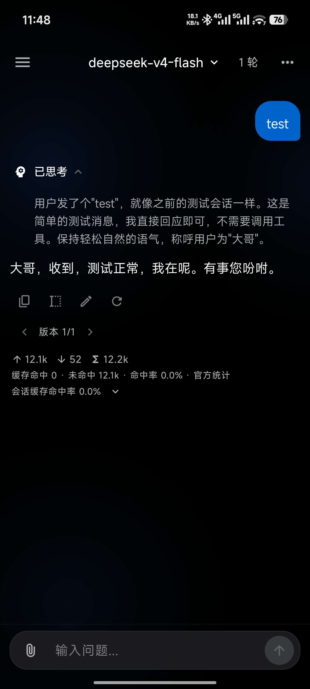<br><sub>回答与思考过程</sub></td>
    <td align="center">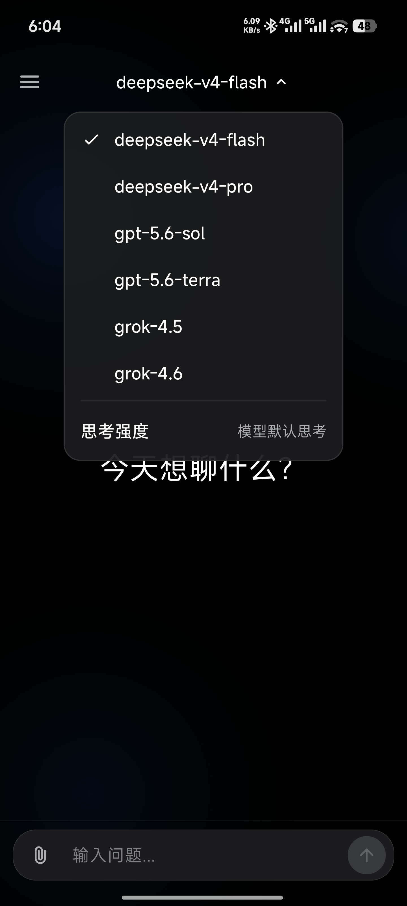<br><sub>模型与思考强度</sub></td>
    <td align="center">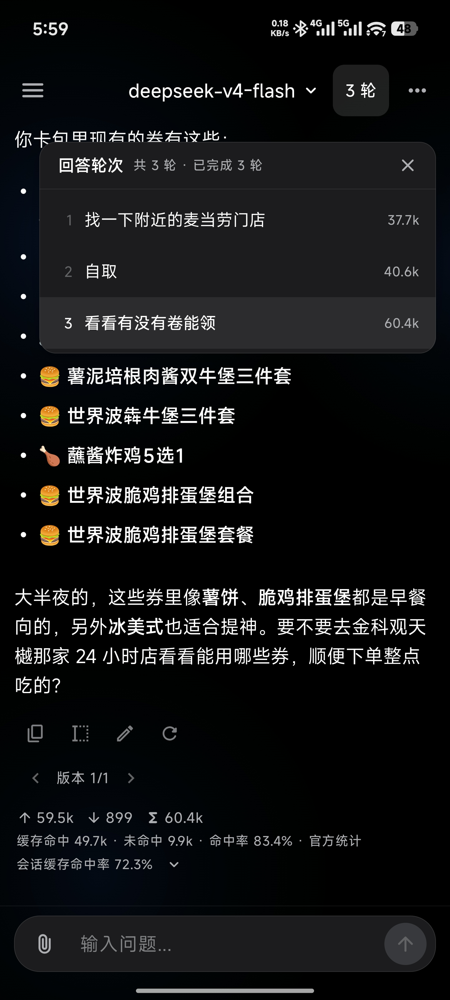<br><sub>回答轮次导航</sub></td>
  </tr>
  <tr>
    <td align="center">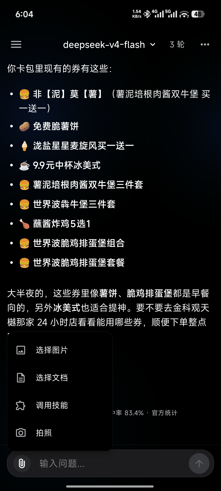<br><sub>相册与相机附件</sub></td>
    <td align="center">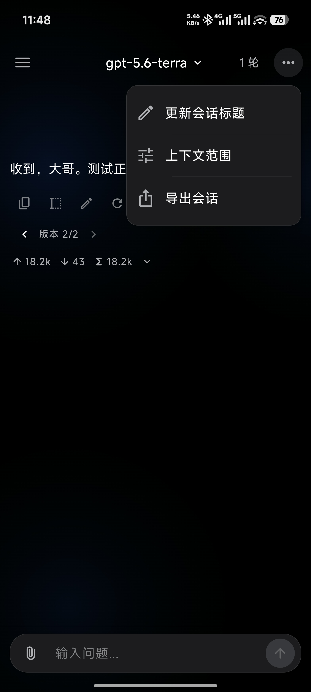<br><sub>会话操作</sub></td>
    <td align="center">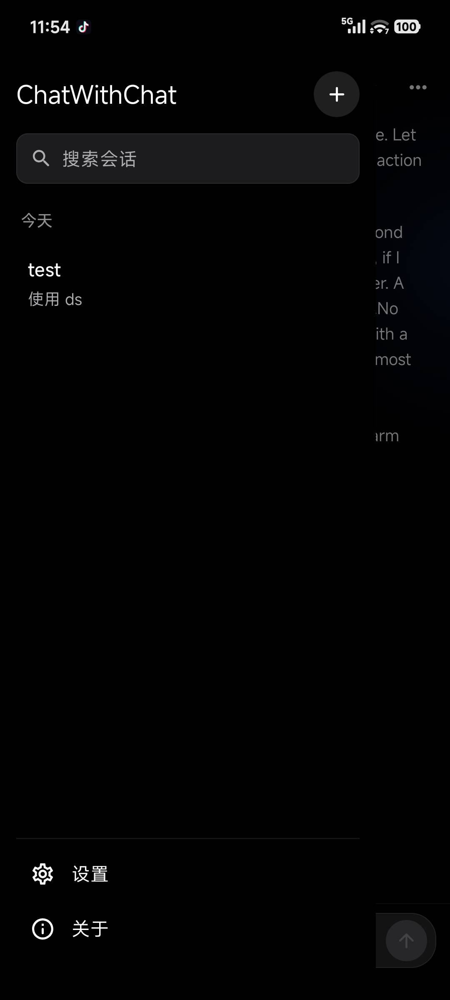<br><sub>会话历史</sub></td>
  </tr>
  <tr>
    <td align="center">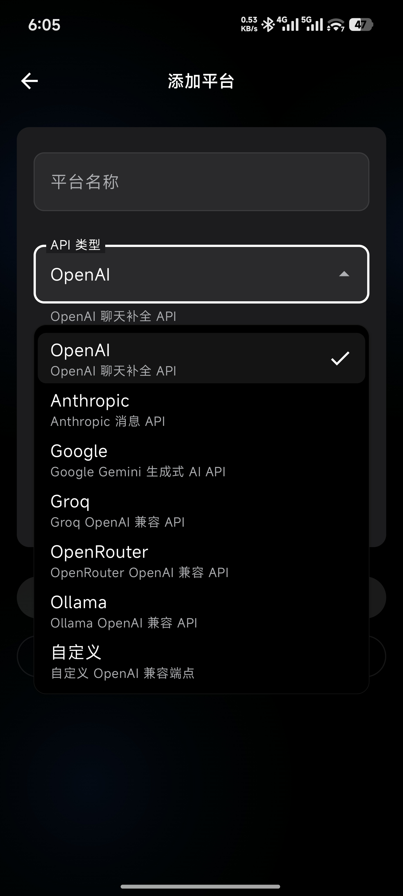<br><sub>添加模型服务</sub></td>
    <td align="center">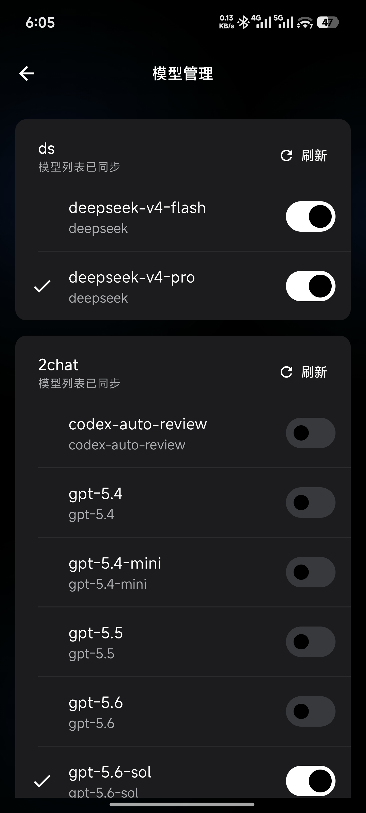<br><sub>模型列表管理</sub></td>
    <td align="center">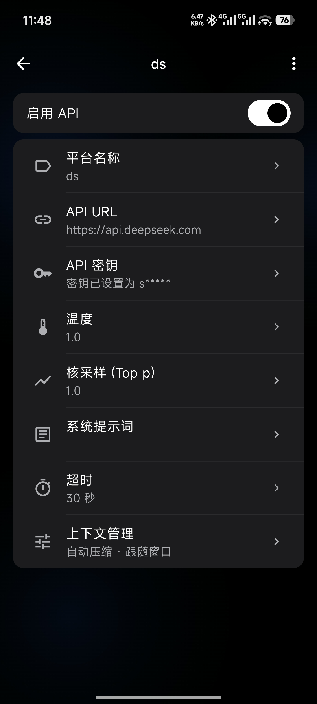<br><sub>平台详细设置</sub></td>
  </tr>
  <tr>
    <td align="center">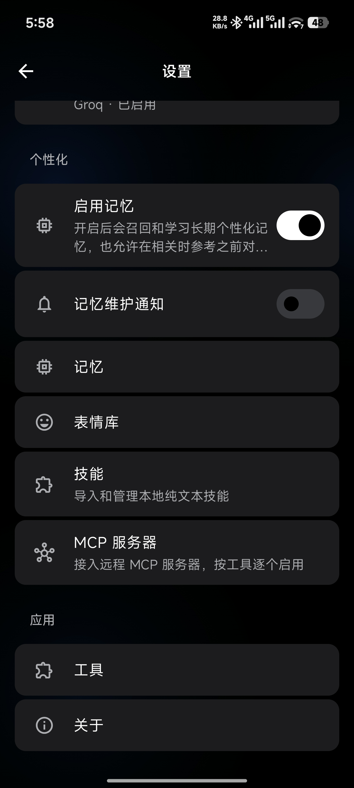<br><sub>应用设置</sub></td>
    <td align="center"><br><sub>本地技能</sub></td>
    <td align="center">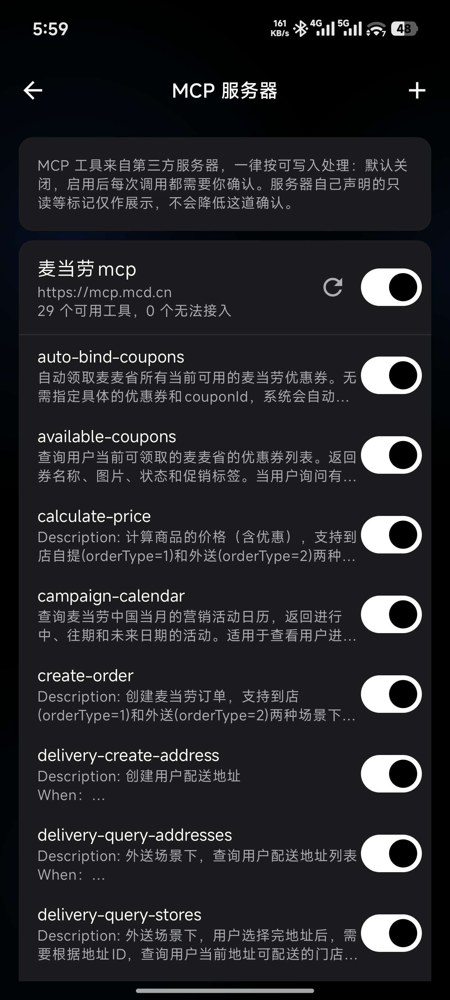<br><sub>MCP 服务器</sub></td>
  </tr>
  <tr>
    <td align="center">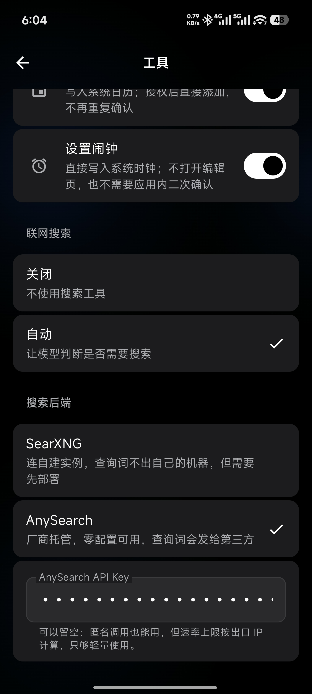<br><sub>工具与联网搜索</sub></td>
    <td align="center">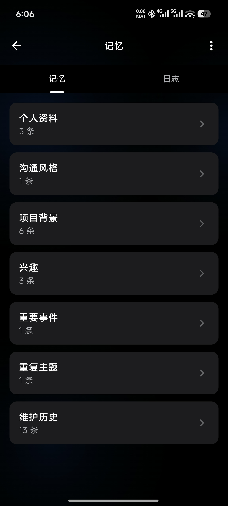<br><sub>长期记忆</sub></td>
    <td align="center">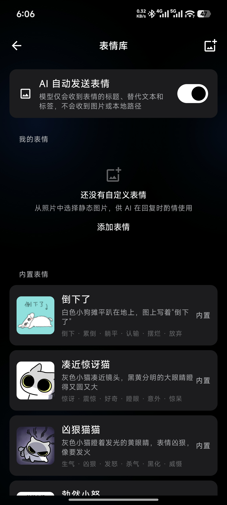<br><sub>表情库</sub></td>
  </tr>
</table>

## 支持的模型服务

添加平台后，应用会从服务端同步模型列表。你可以选择启用的模型、设置默认模型，并为支持的模型选择自动、关闭、低、中、高或最高思考强度。

| 服务类型 | 对话协议 | 工具调用路径 |
| --- | --- | --- |
| OpenAI | Responses API | 原生工具调用 |
| Anthropic | Messages API | 原生工具调用 |
| Google Gemini | Generate Content API | 原生工具调用 |
| OpenRouter | OpenAI Chat Completions | 原生工具调用 |
| Groq | OpenAI 兼容接口 | 结构化 JSON 回退 |
| Ollama | 本地 / 局域网 OpenAI 兼容接口 | 结构化 JSON 回退 |
| Custom | 自定义 OpenAI 兼容接口 | 结构化 JSON 回退 |

不同服务和模型支持的思考参数、视觉输入、上下文长度与工具能力并不完全一致，最终行为仍取决于目标端点的实际兼容程度。

### 推理与思考过程

应用把统一的思考强度转换为各服务实际接受的参数，包括 OpenAI reasoning effort、Anthropic thinking budget、Gemini thinking config、Groq reasoning 字段和 OpenAI 兼容请求参数。通过 Custom 类型连接 `api.deepseek.com` 且模型 ID 包含 `deepseek` 时，应用会发送官方 DeepSeek 使用的 `thinking: {"type":"enabled"}` 配置。

返回链路同时处理以下来源：

- OpenAI Responses API 的 reasoning summary 事件。
- OpenAI 兼容流中的 `reasoning_content` 与 `reasoning` 字段。
- 跨多个 SSE 分片出现的 `<think>...</think>` 与 `<thinking>...</thinking>` 标签。
- 普通对话和工具循环后续轮次中的思考内容。

解析后的思考文本通过 `ApiState.Thinking -> MessageV2.thoughts -> ThinkingBlock` 独立于最终回答保存和展示。结构化字段与标签同时出现时会按来源优先级去重；流结束时仍未闭合的思考标签不会被静默丢弃。

## 快速开始

### 安装发布版

1. 下载 [ChatWithChat v1.2.0 APK](https://github.com/NaBr406/ChatWithChat/releases/download/v1.2.0/v1.2.0.apk)。从 v1.1.0 升级时，先在应用内导出记忆和会话，再卸载旧版。
2. 如需校验完整性，确认 SHA-256 为 `edf3c0c000297db024fd255e2fda80134f2c49141164d140417999d832556265`。
3. 在 Android 12 或更高版本设备上打开 APK，并按系统提示允许当前来源安装应用。

### 首次配置

运行要求：

- Android 12（API 31）或更高版本。
- 至少一个可访问的模型服务端点。
- 对云端服务使用对应 API 密钥；Ollama 可在不配置密钥的情况下使用。

首次启动后：

1. 选择提供商类型并填写平台名称、API URL 与凭据。
2. 等待应用同步模型列表，然后启用至少一个模型。
3. 回到聊天首页，从顶部模型选择器选择模型与思考强度。
4. 如有需要，在设置中开启“启用记忆”（同时控制长期记忆和参考聊天历史）。
5. 需要联网时把工具调用与联网搜索设为自动，并选择 SearXNG 或 AnySearch 作为搜索后端。
6. 需要外部工具或提示词扩展时，可在设置中添加 MCP 服务器或导入本地技能包，两者都默认关闭、需要逐项启用。

如果 Android 设备需要连接电脑上运行的 Ollama，请填写电脑在局域网中的地址；Android 设备里的 `localhost` 指向设备自身。

## 工具调用与联网搜索

工具总开关提供“关闭”和“自动”两种模式。自动模式下，模型可以在当前请求需要时调用已启用工具。内置工具以只读为主，写入型工具单独把关：`add_schedule` 和 `set_alarm` 会写入系统日历与时钟，默认关闭且必须由用户显式启用；表情库额外提供 `search_stickers` 和 `send_sticker`，后者只会从本地已启用目录中选择并展示静态表情：

| 工具 | 用途 | 启用条件 |
| --- | --- | --- |
| `web_search` | 搜索公开网页并返回结构化来源 | 工具调用为自动、联网搜索为自动，并已配置搜索后端 |
| `fetch_url` | 读取公开网页正文 | 与网页搜索相同 |
| `current_datetime` | 读取设备本地日期、时间与时区 | 工具调用为自动 |
| `device_location` | 按需读取设备当前位置 | 默认关闭，需要用户主动启用并授予 Android 定位权限 |
| `add_schedule` | 向系统日历写入日程 | 默认关闭，需要用户主动启用并授予日历权限 |
| `set_alarm` | 通过系统时钟设置闹钟 | 默认关闭，需要用户主动启用（`SET_ALARM` 为安装时授予的普通权限） |
| `search_stickers` | 按语义搜索本地已启用的静态表情 | 工具调用为自动，并启用 AI 自动发送表情 |
| `send_sticker` | 展示模型选定的本地静态表情 | 仅在 `search_stickers` 返回候选后使用 |
| `mcp_<服务器>_<工具>` | 由远程 MCP 服务器提供的工具 | 见下方 [MCP 服务器](#mcp-服务器) |

工具执行前会检查当前启用列表、参数 schema、调用次数、超时、结果大小和 Android 权限。模型生成的调用不会自行弹出系统授权窗口；缺少权限时，应用会返回可恢复错误，由用户决定是否授权。

### 搜索后端

网页搜索需要先选一个后端，两者在隐私和便利之间取舍不同，默认落在 SearXNG 上：

| 后端 | 配置 | 查询词去向 |
| --- | --- | --- |
| SearXNG | 需要填写自建或自选实例的 URL | 只发送到你填写的那个实例 |
| AnySearch | 厂商托管，零配置可用；API Key 可留空 | 发送到 `api.anysearch.com` 这一第三方服务 |

匿名调用 AnySearch 也能工作，但速率上限按出口 IP 计算，只够轻量使用；填入 API Key 后按密钥计费与限速。两个后端返回的都是结构化来源列表，网页正文仍由应用自己从公开 URL 读取。

### MCP 服务器

应用可以接入远程 MCP 服务器**的工具**，不接入 resources 与 prompts。传输方式支持当前规范的 Streamable HTTP 与仍被大量部署使用的旧版 HTTP+SSE；本地 stdio 服务器不在范围内，Android 无法启动子进程。客户端使用 `io.modelcontextprotocol:kotlin-sdk-client`，固定在 0.11.1。

信任模型是这部分的重点，因为工具定义来自第三方：

| 环节 | 处理方式 |
| --- | --- |
| 服务器声明 | `readOnlyHint`、`destructiveHint`、`idempotentHint`、`openWorldHint` 会被记录并展示为“服务器声明（未经验证）”，但**不参与授权判断** |
| 安全策略 | 每个桥接工具一律获得固定的「可写入 + 每次调用需确认」策略，与服务器声称的只读性无关 |
| 默认状态 | 新服务器默认关闭，其工具需要逐个启用；服务器关闭时它的工具完全不进入注册表，模型伪造工具名也无法触达 |
| 逐次确认 | 每次调用都会弹出确认对话框。可以选择“本次会话都允许”，该授权只按（服务器，工具）粒度生效、仅存在于内存，关闭工具或重启应用即失效 |
| 认证 | 用户填写的 Bearer token 与自定义请求头；自定义头不能覆盖 `Authorization`。尚未实现 OAuth 2.1，因此仅支持 OAuth 的托管服务器无法添加 |
| 地址准入 | 拒绝 URL 内嵌凭据与非法 scheme；内网地址需要为该服务器单独打开“允许内网地址” |
| Schema 翻译 | `McpSchemaTranslator` 把服务器 schema 转换为应用能表达的子集：会改变参数结构的关键字（`$ref`、`oneOf`、`if/then`、元组 `items` 等）整体拒绝该工具并给出理由码，只收窄取值的关键字则丢弃并保留属性 |
| 工具命名 | 映射为 `mcp_<别名>_<工具>`，控制在 64 字符内，超长时附带 `(serverId, toolName)` 的短摘要；别名创建时固定，避免改名后孤立已有的启用与授权记录 |

服务器与工具缓存持久化在 `mcp_servers` 与 `mcp_tools` 两张表中，由 schema 23 引入，因此冷启动无需联网即可重建工具目录。单个服务器最多同步 500 个工具、20 页；同步失败时保留上一份目录，不会因为一次网络抖动就抹掉用户已启用并授权的工具。凭据以明文存放在 `mcp_servers.auth_token`，与现有的平台 API 密钥存放方式一致。

完整的翻译规则、预算测算、恢复行为与测试要求见 [工具调用开发指南](./docs/superpowers/tool-calling.md)。当前仍不支持插件市场或任意第三方工具下载。

## 本地技能

技能是纯文本的提示词扩展：导入一个包含若干 `SKILL.md` 目录的 ZIP 包，之后可以在聊天中挂载。技能只提供文本——包内脚本不会执行，也不会因此获得工具或外部连接能力，界面会明确标注“纯文本模式”。

| 环节 | 处理方式 |
| --- | --- |
| 导入门禁 | ZIP 压缩后上限 4 MiB、解压后 16 MiB、最多 512 个条目、单文件 512 KiB；同时拒绝符号链接、多卷与 ZIP64 归档和不安全路径，用于防止 zip bomb 与路径穿越 |
| 元数据 | 解析 `SKILL.md` 前置元数据，并标注为标准、Claude 兼容、已识别发行器扩展或非标准前置元数据 |
| 能力声明 | 技能可以声明所需能力；无法在纯文本模式下满足的能力会被列为“未满足能力”，而不是静默降级 |
| 挂载方式 | 单次请求生效（“仅此请求”）或整个会话生效（“本会话启用”），单次请求最多 8 个技能 |
| 请求预算 | 合计文本上限 512 KiB、约 96,000 估算 token；直接引用文件单个上限 128 KiB，每个技能最多 12 个 |
| 快照 | 每条用户消息保存当次实际使用的技能快照与提示词哈希；删除技能包会停用相关会话绑定，但历史请求快照保持不变 |

会话绑定与请求快照保存在 `session_text_skill_bindings` 与 `message_text_skill_invocations` 两张表中，由 schema 22 引入。

## 图片与文档附件

图片会在准入检查后压缩并按供应商能力内联或走 Files API。文档则在设备本地抽取正文，只有抽出的文字进入提示词，不会上传原始文件字节：

| 类型 | 抽取方式 | 上限 |
| --- | --- | --- |
| PDF | PdfBox-Android 本地解析 | 文件 32 MiB，最多 200 页 |
| docx | 解析 `word/document.xml` | 解压后 XML 16 MiB，容器最多 512 个条目 |
| 纯文本类 | 直接读入（`text/*`、JSON、XML、YAML、TOML、SQL、JS/TS、Shell 等） | 单文件 8 MiB |

单个文档抽取后最多保留 40,000 字符，一条消息内所有文档合计 80,000 字符，超出即截断并在提示中标注。附件本身仍受单文件与单次总量各 50 MiB 的限制。

## 长期记忆

长期记忆默认关闭，并且不是简单地把完整聊天记录拼回提示词。开启“启用记忆”后，应用只记录包含成功助手回答的已完成轮次，将其存入 Room 的待处理队列；每个不可变批次最多 5 轮，在达到 5 轮、用户空闲 30 分钟或发生上下文压缩时进入后台维护流程。这个开关也控制下方独立的参考聊天历史索引与召回。

### 实现分层

| 层级 | 实现与职责 |
| --- | --- |
| 权威内容 | `filesDir/memory_store/MEMORY.md` 是普通聊天召回的唯一事实源；`memory/YYYY-MM-DD.md` 只作为维护输入，蒸馏进入 `MEMORY.md` 前不会参与普通召回 |
| 调度状态 | Room schema 23 保存待处理轮次、聊天检查点、维护任务、活动日志、变更组、变更回执、语料代次和日蒸馏检查点；参考聊天历史的派生表、队列和回填状态也在同一数据库中 |
| 语义整理 | 使用平台列表中首个已启用且已选择模型的兼容平台，把对话批次转换为受约束的 `create`、`replace`、`remove` 或 `ignore` 操作；全语料整理还支持可恢复的 `retire` |
| 一致性提交 | `MemoryMutationCoordinator` 通过幂等键、目标哈希、暂存文件、原子替换和 Room compare-and-set 状态推进提交，避免进程终止后重复写入或回滚新内容 |
| 本地向量化 | 校验固定版本和 SHA-256 的 `bge-small-zh-v1.5` ONNX 资产，在设备上生成 512 维 CLS/L2 向量；该步骤不会调用云端 embedding 服务 |
| 派生索引 | ObjectBox 5.4.2 HNSW 位于 `noBackupFilesDir/memory_vector_index`，只保存可从当前 Markdown 重建的派生状态，不拥有权威内容 |
| 召回 | `HybridMemoryRetriever` 对当前 `MEMORY.md` 同时进行关键词和向量检索，再做融合、去重和多样化；普通长期记忆查询最多保留 8 条结果且不设记忆层 Token 预算，维护工作集仍可使用显式预算；索引缺失、过期或损坏时永久回退到当前 Markdown 关键词召回 |
| 可见性 | 记忆页提供权威 Markdown 的只读查看与导出，以及模型调用、记忆生成、组织结果、重试和失败原因的活动日志 |

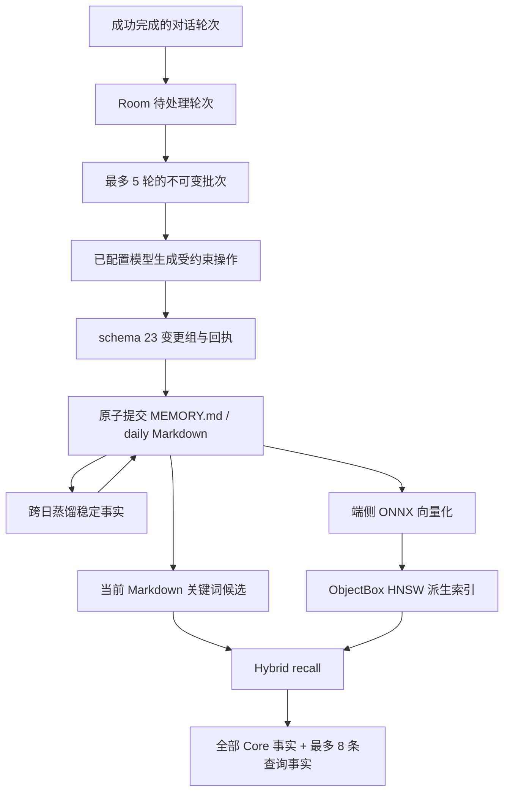

召回查询由最新用户消息和最近 6 条上下文组成，先取最多 24 个候选，再选择最多 8 条查询事实；长期记忆检索本身不设记忆层 Token 预算。Core 事实独立于查询相关性，保留所有符合当前性、可见性和安全校验的事实。最终提示仍受所选 provider 的 context window 和请求预检约束。私密或敏感记忆会保留敏感度元数据，并在注入提示中要求仅在当前请求确有需要时使用，不能因为被召回就主动暴露。

### 恢复与降级

应用启动时会先恢复未完成的变更回执，再进行语料 bootstrap 和向量索引对账。有效租约仍在运行的任务不会被抢占；过期或无主任务通过 CAS 完成恢复。若暂存文件缺失、哈希冲突或目标内容已经写入，恢复流程会分别终止、标记冲突或幂等完成，而不是覆盖当前 `MEMORY.md`。

ObjectBox 索引可以安全删除并从 Markdown 重建。模型资产缺失、损坏、版本不匹配，或者向量快照不新鲜时，embedding capability 保持 `NOT_PROVISIONED`，普通聊天仍使用当前 Markdown 的关键词结果；不会联网下载模型、调用云端 embedding 或使用伪向量替代。

语义整理和日蒸馏仍会调用已配置的对话模型，因此可能产生额外 API 请求与用量。更完整的记忆进程恢复、备份模拟、生产 Hybrid shadow 与 16 KB 验证证据见 [端侧向量记忆就绪文档](./docs/architecture/on-device-vector-memory-readiness.md)，固定模型来源与哈希见 [端侧记忆模型资产契约](./docs/architecture/on-device-vector-memory-artifact-contract.md)。

## 参考聊天历史

参考聊天历史是独立于长期记忆的派生上下文层：它保留可重建的历史投影，用于在新会话中找回相关的过往问答；它不会替换、改写或直接读取 `MEMORY.md` 的权威事实。

| 层级 | 当前实现 |
| --- | --- |
| 隐私开关 | 不新增单独的历史开关，复用“启用记忆”。关闭后不向新请求注入历史，也不消费或写入新的历史索引；已有派生数据保留，重新开启时异步校准 |
| 收录边界 | 只收录有用户消息和成功助手回答的已完成轮次；编辑、删除或不完整的轮次不会进入可用召回，旧投影在重建前会失效，当前会话默认不参与结果 |
| 索引生命周期 | Room schema 23 保存轮次投影、FTS、异步队列、回填检查点、索引代次、embedding 缓存和独立历史向量快照；WorkManager 负责回填、增量修复和重建 |
| 召回路径 | 中文感知的词法检索与端侧语义向量检索融合、去重并按会话分散；最多注入 4 个片段、约 400 Token，每个来源会话最多 2 个片段 |
| 降级与提示 | 向量资产不可用、快照过期或损坏时回退到词法检索；只注入有界的自然语言片段，并标记为不可信历史证据，不包含内部 ID、路径、哈希、诊断字段或附件字节 |

历史召回与长期记忆在同一轮使用冻结的上下文快照，但始终保持独立语料、索引和诊断边界。历史片段只有在相关时才会作为额外上下文发送给所选模型。

## 上下文管理与自动压缩

长对话迟早会超出模型的输入窗口。应用不会静默丢弃消息，而是按供应商决定单次请求携带多少历史、以及超出部分如何折叠。所有策略都只影响请求的组装方式；`messages_v2` 里的原始消息始终保留，也始终可以在界面上翻阅。

预算由模型的**真实输入窗口**推导，而不是模型名字。`ContextWindowResolver` 按三步解析：先用从模型列表接口发现并写入 `platform_model_v2.context_window` 的值，再查一张人工维护的模型族前缀表，最后回退到该供应商类型的保守默认值。名字里带 `-1m` 或 `-128k` 不构成依据。Ollama 例外并直接短路到回退值：应用使用的 OpenAI 兼容端点无法传递 `num_ctx`，实际窗口由服务端设置决定，超出部分会被静默截断。

### 策略与成本档位

供应商设置里提供五个选项。前四个是同一套「检查点 + 最近原文」组装方式的不同成本档位，最后一个改变组装方式本身：

| 选项 | 压缩线上限 | 原文尾巴上限 | 说明 |
| --- | --- | --- | --- |
| 自动压缩 · 节流 | 32K | 8K | 折叠最勤，单次请求最便宜，长对话连贯性相应弱 |
| 自动压缩 · 均衡 | 96K | 16K | 默认档，成本与连贯性的折中 |
| 自动压缩 · 宽裕 | 200K | 48K | 摘要更详细，长对话记得更牢，成本约为均衡档三倍 |
| 自动压缩 · 跟随窗口 | 无上限 | 无上限 | 取消上限，两条线按模型窗口比例计算 |
| 原文优先 | — | 整个可用预算 | 容量允许时按原文发送，超出预算后才压缩较早内容 |

档位只是上限。请求预算先从窗口扣掉输出预留（15%，上限 8192）和安全余量（5%，上限 2048），得到有效输入预算；压缩线取其 75%、后台预折叠线取 60%、原文尾巴取 30%，再分别与档位上限取较小者。因此在小窗口模型上比例先到上限，四个档位表现完全一致；档位只有在窗口大到上限成为决定因素时才起作用。跟随窗口档去掉上限后，1M 窗口模型的单次请求可携带约 297K token 原文，费用可能是均衡档的一二十倍。

「原文优先」不等于「从不压缩」：它把整个剩余预算交给逐字回合，接近预算的 80% 时给出提示，真正超出后仍会折叠较早内容。它也是唯一支持手动选择回合范围的策略。

### 检查点链与后台折叠

折叠的产物是 `context_checkpoint_segment` 里的一条链，每次折叠追加一段，第 N 段的输入包含第 N-1 段的正文。链按 `chat_id + platform_uid` 分开，同一会话切换供应商各自独立；删除会话时随之级联删除，原始消息不会被移动或替换。

折叠在后台进行，复用记忆维护的 `memory_maintenance_job` 队列及其任务类型注册、三层幂等、租约认领与看门狗，不阻塞发送路径。只有当未折叠批次达到摘要目标的两倍时才值得为它调用一次模型——更小的批次换不来实际收缩。判据用的是不受预算钳制的待折叠 token 量：自动压缩档下请求大小本就被预算限死，拿它当信号会让后台折叠永远不入队。

### 原生压缩与降级

连接官方 OpenAI 且模型属于已确认支持的族（当前为 `gpt-5.2`、`gpt-5.3`、`gpt-5.4` 前缀）时，压缩交给 Responses API 的服务端 `context_management`，应用只负责给出阈值并跟踪状态。这张表会过时，新模型族默认按不支持处理，仍可正常聊天，只是走应用侧检查点路径。通过 Custom 类型接入的第三方 OpenAI 兼容网关一律不发送 `context_management`，无论模型名写的是什么。

压缩调用失败、超时或返回不可用内容时，退回确定性的抽取式摘要（最多 8 轮），只用于当次请求的组装，不会写入检查点链——抽取式结果是展示层降级，不是检查点。同一会话 + 供应商反复耗尽重试后进入冷却，避免每轮都排一个注定失败的任务，冷却到期后自动重试。整个降级过程对话都能继续，只是压缩暂时不再是语义压缩。

### 上下文范围

在「原文优先」下，聊天页可以选择从哪一轮开始参与上下文。端点吸附到完整回合边界（一条用户消息加它的助手回答），选择按 `chatRoomId + platformUid` 保存。如果起始回合后来被删除，或不再是有效的回合边界，范围会自动恢复为全部历史并说明原因——修正只会放宽范围，不会删除任何消息。自动压缩档自行决定携带多少历史，界面会说明这一点而不是提供无效的选择器。

## 数据与隐私边界

“本地优先”描述的是数据归属和默认存储位置，不代表所有功能都能离线运行。

| 数据或操作 | 存储 / 传输边界 |
| --- | --- |
| 聊天、平台和运行状态 | 保存在应用私有 Room 数据库中；平台记录包含 API URL 与凭据 |
| 应用偏好 | 保存在应用私有 DataStore 中 |
| API 凭据 | 没有经过项目自建服务器，但当前也没有额外的应用层加密；MCP 服务器的 Bearer token 同样以明文存放 |
| 普通对话与模型列表同步 | 直接请求所选模型服务端点 |
| 联网搜索 | SearXNG 后端只把查询发送到你填写的实例；AnySearch 后端会把查询发送到 `api.anysearch.com`。两者的网页正文都由应用从公开 URL 读取 |
| MCP 工具调用 | 工具名、参数和返回结果在你启用的远程服务器与应用之间传输；每次调用都需要你确认，会话级授权仅存在于内存 |
| 文档附件 | PDF、docx 与纯文本类文档在设备本地抽取正文；只有抽出的文字进入模型请求，原始文件字节不会上传 |
| 本地技能 | 技能包解压后保存在应用私有存储；挂载后其文本内容会作为提示词的一部分发送到所选模型，包内脚本不会执行 |
| 长期记忆语义整理 | 完成轮次、已有记忆和受约束整理提示会发送到已配置的模型服务；模型返回的操作在本地校验后才允许提交 |
| 长期记忆召回 | Markdown、Room 控制状态、ONNX embedding 和 ObjectBox 检索均在设备端运行；普通召回不会调用云端 embedding |
| 参考聊天历史 | 轮次投影、FTS、队列和历史向量快照在设备端派生；启用后只有经过相关性筛选的有界片段会进入模型请求，向量失败时回退到本地词法检索 |
| 表情库 | 图片和元数据保存在应用私有存储；模型仅接收标题、替代文本和标签，不会收到图片字节或本地路径 |
| 设备位置 | 仅在用户主动启用并授权后读取；调用结果会进入所选模型的对话上下文 |
| Android 备份 | `MEMORY.md`、日记忆、Room 和 DataStore 当前符合系统备份条件；暂存/回滚目录、ObjectBox 索引和运行时模型副本不进入备份 |

备份 XML 只显式排除 `memory_store/.staging/` 和 `memory_store/.backups/`。ObjectBox 与运行时安装的模型位于 `noBackupFilesDir`，恢复后从权威 Markdown 或 APK 资产重新建立。Room、DataStore、平台凭据和权威记忆是否实际进入云备份或设备迁移，仍取决于设备设置和 Android 备份 transport；当前 API 凭据没有额外的应用层加密，使用系统备份前应理解这一边界。

## 本地开发

### 环境要求

- JDK 17。
- Android Studio 与 Android SDK 36。
- Windows PowerShell，或能运行 Gradle Wrapper 的类 Unix 环境。
- 设备测试需要 Android 12+ 真机或模拟器。

项目是单 `app` 模块，`namespace` 与 `applicationId` 均为 `cn.nabr.chatwithchat`。

```powershell
git clone https://github.com/NaBr406/ChatWithChat.git
Set-Location ChatWithChat

# Debug APK
.\gradlew.bat :app:assembleDebug

# Kotlin 快速编译检查
.\gradlew.bat :app:compileDebugKotlin

# JVM 单元测试
.\gradlew.bat :app:testDebugUnitTest

# 连接设备后的 instrumented tests
.\gradlew.bat :app:connectedDebugAndroidTest

# 历史索引进程终止与恢复测试（需要恰好一个已连接设备）
.\tools\history\run-process-death-harness.ps1

# MCP 相关的 JVM 测试
.\gradlew.bat :app:testDebugUnitTest --tests "cn.nabr.chatwithchat.data.mcp.*"

# MCP SDK 的设备端加载与握手门禁（SDK 尚未到 1.0，且不声明支持 Android）
.\gradlew.bat :app:connectedDebugAndroidTest -Pandroid.testInstrumentationRunnerArguments.class=cn.nabr.chatwithchat.data.mcp.McpSdkBuildCanaryInstrumentedTest
```

macOS / Linux 下将 `.\gradlew.bat` 替换为 `./gradlew`。代码格式由 ktlint 1.3.1 按 `.editorconfig` 在 Pull Request 中检查。

### Windows 构建脚本

```powershell
# 默认构建 arm64-v8a Debug APK，输出到 dist/
.\build-apk.ps1

# 为 x86_64 模拟器构建
.\build-apk.ps1 -TargetAbi x86_64

# 构建、安装并启动 Debug APK
.\run-on-emulator.ps1

# 复用已有 Debug APK
.\run-on-emulator.ps1 -NoBuild
```

`build-apk.ps1` 也接受 `armeabi-v7a` 和 `x86`，但当前生产兼容验证重点是 `arm64-v8a` 与 `x86_64`；32 位 ABI 仍需单独验证。

### Release 构建

生产 Release 包含固定版本、固定哈希的端侧记忆模型。模型二进制不提交到 Git，干净工作区需要先准备并校验资产：

```powershell
.\tools\memory-model\provision-bge-small-zh-v1.5-production.ps1
.\gradlew.bat :app:verifyProductionMemoryModelArtifacts :app:assembleRelease
.\gradlew.bat :app:bundleRelease
```

也可以使用仓库脚本完成模型准备、单 ABI 构建、签名和 APK 检查：

```powershell
.\build-apk.ps1 -Release
```

未传入 `-Keystore` 时，脚本会使用本机 Debug keystore 生成便于安装验证的 Release 变体。正式分发必须传入自己的发布 keystore，并妥善管理密钥与密码。模型资产的来源和完整性约束见 [端侧记忆模型资产契约](./docs/architecture/on-device-vector-memory-artifact-contract.md)。

发布验证脚本会检查固定模型资产、Release R8 构建、APK 16 KB ZIP 对齐，以及 ObjectBox / ONNX Runtime 原生库的 ELF 对齐；连接设备后还可以扩展到运行时门禁：

```powershell
# 构建并检查 Release APK
.\tools\memory-vector\verify-release.ps1

# 在 PAGE_SIZE=16384 的设备或模拟器上要求 16 KB 运行时证据
.\tools\memory-vector\verify-release.ps1 -RunDeviceTests -Require16KbPageSize

# 运行真实 ONNX + ObjectBox 的生产 Hybrid shadow
.\tools\memory-vector\run-production-hybrid-shadow.ps1
```

当前 `arm64-v8a` 与 `x86_64` 的目标原生库已经通过 16 KB ELF 对齐验证。`armeabi-v7a` 与 `x86` 仍属于单独的 32 位支持策略，不应把 64 位门禁结论直接外推到 32 位产物。

## 架构概览

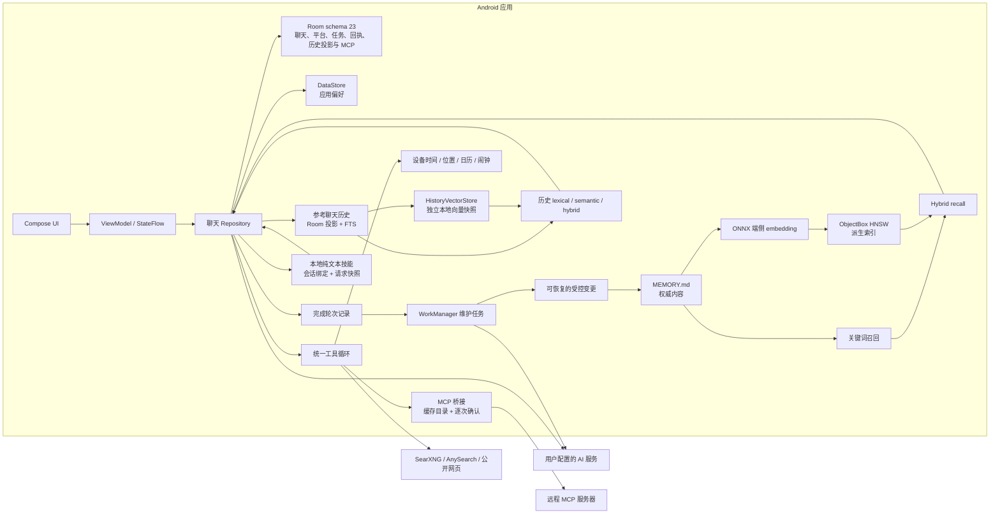

主要代码目录：

- `app/src/main/kotlin/cn/nabr/chatwithchat/presentation/`：Compose UI、导航与 ViewModel。
- `app/src/main/kotlin/cn/nabr/chatwithchat/data/network/`：各模型服务的网络客户端。
- `app/src/main/kotlin/cn/nabr/chatwithchat/data/repository/`：聊天、设置、附件、模型发现、推理流解析和记忆上下文装配。
- `app/src/main/kotlin/cn/nabr/chatwithchat/data/tool/`：工具注册、执行、安全策略、审批与 provider adapter。
- `app/src/main/kotlin/cn/nabr/chatwithchat/data/mcp/`：MCP 客户端连接、`tools/list` 同步、schema 翻译、工具命名与注册表桥接。
- `app/src/main/kotlin/cn/nabr/chatwithchat/data/textskill/`：技能包导入校验、前置元数据解析、引用解析与请求编译。
- `app/src/main/kotlin/cn/nabr/chatwithchat/data/attachment/`：PDF / docx / 纯文本正文抽取与文档提示词合成。
- `app/src/main/kotlin/cn/nabr/chatwithchat/data/websearch/`：SearXNG 与 AnySearch 搜索、网页提取与网络安全策略。
- `app/src/main/kotlin/cn/nabr/chatwithchat/data/memory/`：批次整理、日蒸馏、原子变更、恢复、Markdown、端侧 embedding、ObjectBox 与 Hybrid recall。
- `app/src/main/kotlin/cn/nabr/chatwithchat/data/history/`：历史轮次投影、FTS/向量召回、索引队列、回填与 WorkManager 调度。
- `app/src/main/kotlin/cn/nabr/chatwithchat/data/database/`：Room entity、DAO、schema migration，以及记忆任务、历史索引、回执、语料代次与 MCP 状态。
- `app/src/test/kotlin/`、`app/src/androidTest/kotlin/`：JVM 与设备测试。

技术栈包括 Kotlin、Jetpack Compose、Material 3、Hilt、Room、DataStore、WorkManager、Ktor CIO、kotlinx.serialization、ObjectBox、ONNX Runtime、PdfBox-Android 与 MCP Kotlin SDK。

## CI 与发布流程

- Pull Request 会执行 ktlint 检查；相关代码变更会触发 Debug APK 构建。
- CodeQL 在 Pull Request 和每周定时任务中运行。
- 推送标签或手动触发 Release workflow 时，会准备记忆模型、构建并签名 APK / AAB，再上传为 Actions artifact。
- 当前 CI 不会运行完整 JVM / 设备测试，也不会自动创建 GitHub Release；Actions artifact 与正式发布仍是两个独立步骤。
- `v1.2.0` 已作为正式 GitHub Release 发布，公开资产为 [`v1.2.0.apk`](https://github.com/NaBr406/ChatWithChat/releases/download/v1.2.0/v1.2.0.apk)。

提交代码前，请至少运行与修改范围对应的单元测试和 `:app:compileDebugKotlin`；数据库、记忆、权限或 Android 生命周期改动还应补充设备测试。改动 MCP 客户端或升级 MCP SDK 时必须跑一次 `McpSdkBuildCanaryInstrumentedTest`——SDK 尚未到 1.0，也不声明支持 Android，需要在 ART 上实测能加载并完成握手。

## 反馈

- [提交 Bug](https://github.com/NaBr406/ChatWithChat/issues/new/choose)
- [查看 GitHub Actions](https://github.com/NaBr406/ChatWithChat/actions)

报告问题时，请附上 Android 版本、提供商类型、模型 ID、API URL 类型、复现步骤，以及必要的截图或 logcat 片段。请勿公开 API 密钥、完整请求头或其他敏感信息。

## 项目背景与许可证

ChatWithChat 基于 [GPT Mobile](https://github.com/Taewan-P/gpt_mobile) 持续改造，现使用独立的项目身份与 Android 包名 `cn.nabr.chatwithchat`。旧的 `dev.chungjungsoo.gptmobile` 安装包不会被 Android 视为本项目的原地升级版本，两者的数据也不会自动迁移。

本项目按 [GNU General Public License v3.0](./LICENSE) 发布。应用内“开源许可”页面列出了所使用第三方依赖的许可证信息。
